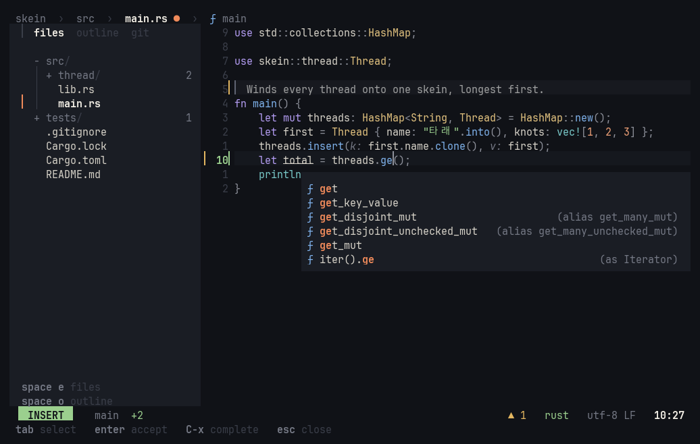
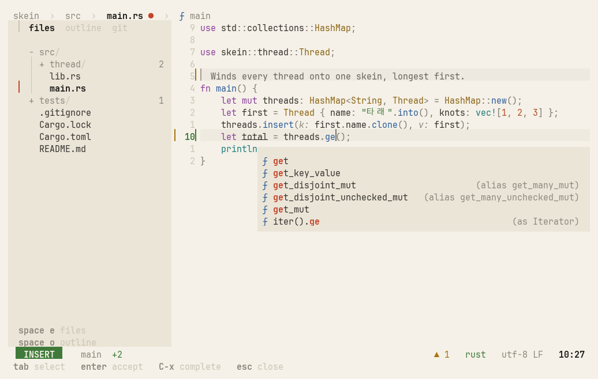

# tarae (타래)

> *Tarae* is a skein of thread — wound on from the feel of Helix, spun from fresh yarn.

<p align="center">
  
  
</p>

tarae is a terminal editor that keeps **Helix's keymap, its selection → action grammar, and its batteries-included spirit** —
and rebuilds everything else to fix what bothered us about Helix. It is not a fork.

| Helix pain point | tarae |
|---|---|
| Settings are a chore to change | One TOML file, applied on save; `:set` at runtime with descriptions and completion |
| Slow when a language server attaches | Keystrokes and rendering never wait — LSP, parsing, disk, and git all run in the background |
| No LLM support | Select → instruct → diff review, a chat panel, and Claude Code integration, built in |
| Immature plugins | Features go straight into the core; for the rest, [plugins](docs/plugins.md) in Rust run sandboxed on tarae's own small WebAssembly runtime |

**Status: early.** Version 0.1, no releases yet — build it from source. Keys, settings, and features still change
quickly.

## Quick start

```sh
git clone https://github.com/ethnw/tarae && cd tarae
cargo install --path .                               # Rust 1.90+ and a C compiler
# cargo install --path . --features bundled-grammars # or: 26 common grammars built in, nothing to download later
tarae path/to/file        # or a folder: tarae .  — the start screen, space f for its files
```

No need to learn the keys first:

- **`space ?`** — command palette: find any command by what it does, with its key on the right ([screenshot](docs/screenshots/ux-palette.png))
- **which-key** — press `space`, `g`, `m`, `[`, or `]` and a card shows what comes next ([screenshot](docs/screenshots/ux-which-key.png))
- **`:tutor`** — a 10-minute hands-on tutorial in a practice buffer ([screenshot](docs/screenshots/ux-tutor.png))
- **Start screen** — launched without a file, it shows first steps and recent files ([screenshot](docs/screenshots/ux-welcome.png))

Rust, TOML, and Markdown are highlighted out of the box. Open a file in any other language and tarae offers to download its grammar — press `y`.

### What you need

- **macOS or Linux.** Windows isn't supported natively — tarae relies on Unix process and terminal APIs — but it runs
  under WSL like on any Linux, and `space y`/`space p` use the Windows clipboard there.
- **Language servers, test runners, and debuggers** are the usual external tools, found on your `PATH` — see
  [Language support](docs/languages.md) for what each language needs.
- **Claude features** need [Claude Code](https://claude.com/claude-code) (`claude`) installed and logged in. Everything
  else works without it.
- Optional: `git` (the file list respects `.gitignore`; the git tab and gutter), `rg` (faster global search).

## Highlights

- **Never makes you wait.** Worst key → frame on a 200k-line file: 1.0 ms debug, 52 µs release (budget 16 ms, enforced by a test).
  A 100 MB file shows its first screen in 18 ms.
- **Claude as a verb.** Select, `space i`, type an instruction — the answer streams in and lands as an in-buffer diff you accept change by change.
- **Claude Code knows your editor.** The `claude` in a side pane (or tarae's own terminal) sees your selection and diagnostics, and its edits arrive in tarae for review.
- **Language tooling included.** LSP (completion, signature help, inlay hints, code actions with a diff preview, rename),
  plus a test runner and debugger for Rust, Go, Python, and Java — including attaching to remote programs.
- **The workbench, without leaving the keys.** A side panel with the project's files, this file's outline, a build's
  errors, and git (stage, commit, push); build tasks whose errors `]q` walks; a terminal below the code; merge
  conflicts settled with a key; `:diff` against any revision.
- **Made to be looked at.** Two themes, meok (ink) and hanji (paper), picked from your terminal's background. Everything floating is a card
  that speaks the same color language as the code.

## Coming from Helix

The keys, command names, and key-config notation are Helix's — a `[keys.normal]` table from your Helix config works
as it is (put it in tarae's config). Where tarae needed a key for something Helix doesn't have, it took these:

| Key | In tarae | In Helix |
|---|---|---|
| `space c` · `space C` | Claude Code beside tarae · send it the selection | Toggle comments — here `C-c` |
| `space g` | The git panel, lazygit-style: files → their hunks and conflicts (`s` stage, `d` discard, `o`/`t`/`a`), commit (`C`: Claude drafts the message), `p`/`P` pull/push, `B` branches, `L` log, stash — `?` lists them | Changed files (a picker) |
| `space e` · `space o` · `space q` | Side panel: files · outline · the list (quickfix) | File explorer (a picker) |
| `space i` · `space l` · `space n` · `space v` | Ask Claude to edit the selection · chat · a note on the line · review your changes | — |
| `space u` · `space U` | Undo what Claude changed in its last turn, across files · bring it back | — |
| `space m` · `space x` · `space T` | Build tasks · tests · terminal | — |
| `]q` `[q` · `]x` `[x` · `]m` `[m` · `]n` `[n` | The list · failed tests · conflicts · notes | — |

Everything else — `space f`, `space /`, `gd`, `m` mode, `z` view mode, `C-w` windows, `space G` debugging — is where
Helix has it. The [keymap reference](docs/reference/keymap.md) lists every key.

## What's inside

| Area | In short |
|---|---|
| [Editing](docs/features.md#editing) | Helix keys and command names, multiple cursors, regex selection, tree-sitter text objects, surround, registers, macros |
| [Look and feel](docs/features.md#look-and-feel) | meok and hanji themes, cards, path bar, status line, toasts, rendered doc comments, indent guides |
| [Getting around](docs/features.md#getting-around) | Fuzzy pickers with preview, a side panel (files, this file's outline, the list of places, git), global search, live search highlighting, split windows, `:` completion |
| [Build and run](docs/features.md#getting-around) | Build tasks whose errors fill a list `]q` walks, a built-in terminal below the code |
| [Files and git](docs/features.md#files-and-git) | Disk sync without losing undo, auto-save, session restore, persistent undo, git gutter, a git tab (stage, commit, push), merge conflicts, `:diff` |
| [Syntax highlighting](docs/features.md#syntax-highlighting) | Tree-sitter for 54 languages, grammars offered on first open, injections, indentation from the tree |
| [Language servers](docs/features.md#language-servers) | Diagnostics, completion, signature help, inlay hints, code actions with a diff preview, rename, symbols, several servers per file — and [Java](docs/features.md#java) via jdtls |
| [Tests](docs/testing-and-debugging.md#tests) | Run or debug the test at the cursor; failures marked on their line — Rust, Go, Python, Java |
| [Debugger](docs/testing-and-debugging.md#debugger) | DAP for Rust, C/C++, Go, Python, Java — inline values, conditions, logpoints, watches, [attach](docs/testing-and-debugging.md#attaching-to-a-running-program) |
| [Claude](docs/claude-integration.md) | Select → instruct → diff; a chat where Claude reads your project while the editor follows along, lays out a plan, runs the tests to check its edits, and pins notes on the code you answer in place; a pull-request-style review of the changes whose comments go back to Claude in one go; Claude Code in a side pane |
| [Plugins](docs/plugins.md) | Commands of your own in Rust, compiled to WebAssembly and sandboxed; `tarae plugin new` starts one, `tarae plugin dev` reloads it as you work |


## Configuration

`~/.config/tarae/config.toml`, plus an optional project `.tarae.toml`. It's plain TOML, applied on save, and a
setting's name is its `:set` path — `:set editor.scrolloff 8` for this session, `:set!` to also write it to the file.

```toml
theme = "default"          # meok · hanji · …-transparent · default (follows the terminal)

[editor]
auto-save = "idle"         # "focus" · "idle" · "off"

[keys.normal]
"A-," = "goto_previous_buffer"
```

More in the [configuration guide](docs/configuration.md); every setting is in the [settings reference](docs/reference/settings.md).

## Documentation

- [Features](docs/features.md) — editing, look and feel, navigation, files and git, syntax, language servers, Java
- [Tests and debugging](docs/testing-and-debugging.md) — test runner, debugger, attaching to running programs
- [Claude](docs/claude-integration.md) — select → instruct → diff, chat panel, Claude Code integration
- [Language support](docs/languages.md) — language servers, test runners, and debuggers per language
- [Configuration](docs/configuration.md) — files and layers, `:set`, keys, language servers, custom themes
- [Plugins](docs/plugins.md) — installing them, writing one in Rust, what they can see and do
- Reference (generated from the code): [settings](docs/reference/settings.md) · [default keymap and `:` commands](docs/reference/keymap.md)
- [Architecture](docs/architecture.md) — principles, design language, roadmap, source layout
- [Contributing](CONTRIBUTING.md) — how to build, test, and send changes

## License

tarae is licensed under the [GNU General Public License, version 3 or later](LICENSE) (`GPL-3.0-or-later`).

- The query files in `runtime/queries/` come from Helix and stay under MPL-2.0 (see [NOTICE](runtime/queries/NOTICE)
  and [their license](runtime/queries/LICENSE)). MPL-2.0 files can be part of a GPL program.
- Grammar sources in `runtime/grammars.tar.gz` keep their upstream licenses.
- The plugin SDK — `plugin-sdk/wit`, `plugin-sdk/template`, `plugin-sdk/sdk` — is MIT OR Apache-2.0, so plugins can
  be under any license ([plugin-sdk](plugin-sdk/README.md#license)).
- Everything up to commit `be9c633` (2026-09-28) was released under MPL-2.0 and stays available under it.

Contributions need a signed Contributor License Agreement. See [Contributing](CONTRIBUTING.md#license-and-the-cla).
