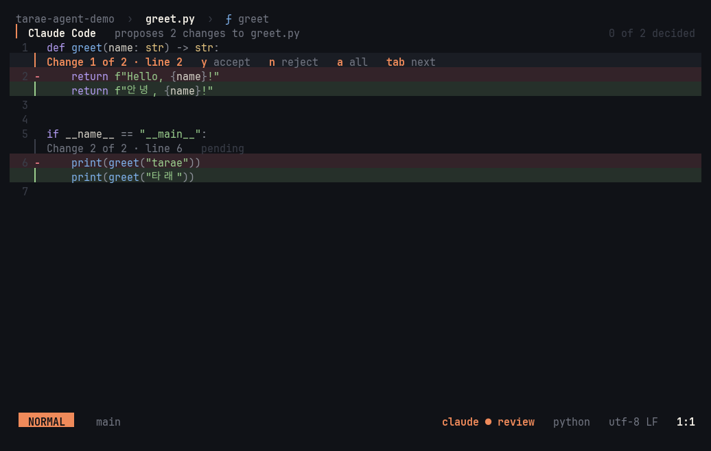

# Claude

tarae works with Claude in two ways: it asks Claude itself (edit a selection, or chat in a side panel), and it lets the
Claude Code you already run in a terminal pane see and edit what's in the editor.

tarae runs the `claude` CLI as a subprocess — there's no HTTP client, SDK, or API key in the editor; it uses your
Claude Code login as it is. You need [Claude Code](https://claude.com/claude-code) installed and
logged in.

- [Select → instruct → diff](#select--instruct--diff)
- [Chat panel](#chat-panel) — [follow mode](#follow-mode), [the plan](#the-plan), [edits](#edits), [undoing a turn](#undoing-a-turn), [running the tests](#running-the-tests), [running commands](#running-commands), [notes](#notes)
- [Commit messages](#commit-messages)
- [Code review](#code-review)
- [Claude Code integration](#claude-code-integration)
- [Settings](#settings)

## Select → instruct → diff

In a selection-first editor, Claude takes the *action* slot: select, then tell it what to do.

1. Select one or more pieces of text (multiple cursors work — Claude answers for each selection)
2. `space i` (or `:ask <instruction>`) and type the instruction
3. The answer streams into a card at the bottom right (thinking/writing, elapsed time) while you keep editing
4. It opens as an **in-buffer review**: the whole file stays in view with only the changed spots expanded — deleted
   lines on faint red, added lines on faint green, both in the file's syntax colors, a header line per change

| Key | In the review |
|---|---|
| `y` / `n` | Accept / reject this change |
| `a` | Accept all |
| `q` | Reject the rest |
| `tab` | Next change |
| `j` / `k` | Scroll |

Accepted changes apply as one transaction — one `u` undoes them all. If the original text moved while you waited, it's
found again and the change still lands in the right place. `:ask-cancel` kills the process, so token generation stops
too ([screenshot](screenshots/m4-review.png)).

**Speed**: a fresh `claude` process takes 8–10 s to start, so tarae starts one the moment the prompt opens, while you
type. Enter → diff takes about 3.4 s with the default model.

## Chat panel


`space l` (or `:chat [question]`) opens a panel on the right; `space L` closes it and `:chat-new` starts over. One
process lives for the whole conversation, so Claude remembers what came before.

**The model** is named in the chat's title while it's idle (`Opus 5.5 · high`). `C-t` in the chat (or `:model`,
or "Choose Claude's model" in the palette) lists the models your `claude` offers, with the one in use marked
([screenshot](screenshots/chat-model.png)). `:effort` sets how hard it thinks, for models that take it. The
choice applies to the conversation at once, with no restart and no lost context: the next answer comes from the
new model. It's also saved (`llm.model`, `llm.effort`), so `space i` and later sessions use it too.

Conversations outlive tarae. Each one is kept for its project, and Claude's memory of it is its own session
(`claude --resume`). Open the chat after a restart and the latest conversation carries on (`continued from 2 h
ago`) if you used it in the last 8 hours. Otherwise you get a fresh chat, and the empty panel lists your earlier
conversations. `C-p` in the chat (or `:chat-resume`) picks any of them, with the conversation as the preview
([screenshot](screenshots/chat-conversations.png)). The last 20 conversations of a project are kept, in
`~/.local/state/tarae/chats/`. Because the chat's sessions are kept, they also show in `claude --resume` in
that folder.

Every message carries **the current file, cursor, selection, and diagnostics** as context, plus **what's on
screen**: the lines you're looking at, and the file in the pane beside it when the window is split. So "this" and
"here" mean what you see, even when the cursor is somewhere else — the whole file only the
first time a version is sent, and just the area around the cursor for files over 60 KB. What was sent shows as chips
above your message (`main.rs · L13–18 · 3 diagnostics`). Answers render as Markdown, with code blocks in their
language's colors.

The chat reads your CLAUDE.md files and Claude Code settings the way `claude` does, so project rules apply to its
answers and edits. Two things differ on purpose: hooks don't run, and edits always come to you as a review, even
if a settings file allows them. `llm.chat-settings = false` starts it clean.

Claude isn't limited to that file: it **explores the project itself** (Read, Grep, Glob — allowed up front; its
[edits](#edits) always come to you first). Each lookup shows as a quiet row (`◦ read  src/lib.rs  L10–49`, `◦ search  fn add  in src`),
the one in progress marked `●`. The other open files are listed in the context, and unsaved ones send their text,
since Claude would otherwise read the stale copy on disk. Answers cite code as `path:line`. Those references are
underlined, and a click opens them. `C-]` (or `C-g` — zellij takes that one) walks every place the conversation points at, newest first, centering
each one while the chat keeps the keys.


| Key | In the chat |
|---|---|
| `enter` | Send |
| `alt-enter` / `C-j` | New line |
| `C-c` | Stop the answer (the conversation stays) |
| `C-r` | Replace the selection with the answer's code — through the same review |
| `C-y` | Copy the code |
| `C-]` (`C-g`) | Go to where Claude looked or pointed (again = one further back) |
| `C-f` | Follow mode on/off (resumes if you took over) |
| `C-z` | Undo what Claude changed in its last turn ([more](#undoing-a-turn)) |
| `C-l` | New conversation |
| `C-p` | Continue an earlier conversation |
| `C-t` | Choose the model (`:effort` — how hard it thinks) |
| `esc` | Back to the editor |

### Follow mode


([hanji theme](screenshots/follow-hanji.png))

Follow is on by default (`C-f` in the chat toggles it; `llm.follow = false` starts with it off). The editor goes
where Claude is reading while it works. Each file it reads opens with the cursor on the first line read, centered, and those lines
get a faint accent wash. A search jumps to its first hit, and the finished answer takes you to its first
`path:line`. A card beside the code shows what Claude is doing (`● reading  src/llm.rs  L230–249`) and what it's
thinking, as a running log of the turn: a new thought goes under the last one instead of replacing it, so you
can follow the reasoning at your own pace ([screenshot](screenshots/follow-thinking.png)). Claude's thinking arrives as summaries, and the chat keeps each one as a folded italic aside. While
Claude works, the chat minimizes to a small card at the bottom right: your question, its last few lookups
(each a link) and the keys. The code gets the whole width, and the thought card takes the room above the lines
being read. The panel comes back with the finished answer, or right away with `space l` or a click on the card.

It follows what Claude talks about, too, not only what it reads. While it thinks, every `path:line` or
`path:start-end` it mentions shows at once, and a `name` in backticks goes to that definition in a file open here.
When it explains how something works, Claude writes a walk-through into its answer: a
`<show at="path:start-end">what this code does</show>` line before each piece, in the order of the flow (the
chat shows each as a link line). The editor shows the stops one by one, each for about as long as its
explanation takes to read, with the card saying what that code does there and which stop it is
([screenshot](screenshots/follow-show.png)). The stops go into the list (`]q` walks them again). The list is
announced once the tour is over, so its message doesn't compete with the stop's card. Scrolling the
chat stops the tour and moves the editor to the first reference the chat shows, so the code follows what you're
reading. It's plain text in the answer: no extra requests, a few words per stop.


You can talk back at a stop. Once the answer is done, the stop's card says `space n ask about this`. The last
stop's card stays as long as your cursor is in its lines, even after the tour ends. Press `space n` and the tour
holds still while you type. Your question becomes a [note](#notes) on the stop's lines, and Claude gets
those lines along with what it said about them there. It answers in the note, next to the code.

Files opened along the way are previews: unedited ones close when follow moves on. Moving the cursor, switching
files, or scrolling in the editor takes over: following pauses (`claude › paused`) until `C-f` or your next
question. `C-o` jumps back to where you were before the turn.

An empty conversation shows a short guide and example questions you can pick with `tab`
([hanji theme](screenshots/m4-chat-hanji.png)).

### The plan


When the work takes several steps, Claude lays them out first and keeps the list current as it goes. It uses
tarae's `plan` tool for this. The plan is pinned under the chat's title with how far along it is (`2/4`).
Finished steps recede (`●`), the step in hand is in the accent (`›`), and the rest wait (`◦`). While Claude
works and the chat is minimized, the card shows the step in hand. A review of an edit made with no words
before it is headed by that step. When everything is done, the plan folds into one row (`all 4 done`). The
plan belongs to its conversation: it's kept and continued with it, and `C-l` starts without one.

### Edits


When you ask for a change, Claude edits files from the chat too, across as many files as it takes. Nothing is
written until you've seen it: each edit opens as the same in-buffer review as select → instruct → diff (`y`/`n`
per change, `a` all, `q` reject the rest), headed by what you asked for. Under that title, Claude's own
words from just before it made the edit say why ([screenshot](screenshots/chat-edit-why.png)): what it
concluded, in a row or two. Its full reasoning is in the chat. The accepted changes are what gets
written. Accept part of a change, and only that part is written. Decline, and Claude is told so. Several edits
queue up one after another.

A file with unsaved edits is a special case, because disk isn't what you're looking at. The accepted change stays
in your buffer, and Claude is told the file changes when you save.

### Review at the end


A long piece of work can mean dozens of edits, and a `y`/`n` for each one. Review at the end lets Claude work
through it and shows you the whole change once, the way you'd read a pull request. `space v a` (or
`:review-at-end on`) asks first, on a card that says what it means: Claude's edits go into your files as it makes
them, before you see them, and the checks it runs (`cargo test`, `cargo build`) run that code. `y` turns it on for
this chat. The chat's title says `› review at end` while it's on, and `space v a` turns it off. A new chat
(`C-l`) starts with it off.


When the turn ends, the files Claude changed open as a [code review](#code-review), each against what it was before
the turn. What you asked is under the rail's head. `]g` walks the changes across files, `space v u` takes the change
at the cursor back, `space u` takes the whole turn back, and `space v q` keeps the rest. `space n` comments and
`space v s` sends your comments to Claude, as in any review. `space v t` (`:review-turn`) opens Claude's latest turn
as a review again, whether or not it was made this way.

Some edits still ask first, one at a time:

- files outside the project (where the link or `..` really leads)
- anything in `.git`, and the files in `llm.review-ask`: build scripts, manifests, and settings that decide what
  runs (`build.rs`, `Cargo.toml`, `package.json`, `Makefile`, `.tarae.toml`, `.cargo/`, `.github/`, `.claude/`, …).
  A name matches anywhere in the project, and a path with `/` matches from its root
- a file with unsaved edits of yours

The turns are kept on disk per project, so `:restart` (or a crash in the middle of a turn) doesn't lose them.
After a crash, a turn that was cut short comes back as a turn of its own, and you can review it and take it back.

### Undoing a turn


Whatever Claude changes in one turn is one step back, however many files it touched. When the turn ends, the
chat notes it (`changed sub.rs, lib.rs · space u undo`). Press `space u` anywhere (or `C-z` in the chat, or
`:undo-turn`) to put every one of those files back as it was before the turn. A file the turn created is
removed. `space U` (`:redo-turn`) brings the turn back. Press `space u` again to go back one more turn.

An accepted `space i` answer and an accepted Claude Code diff are steps of their own too: `space u` takes the
latest back, whichever it was.

Your own edits since the turn stay. Only Claude's changes are taken out. Where you edited on or right next to
one of Claude's changes, that change is left alone too, and the toast says how many were left. Each file
changes as one step, so `u` in that file takes the undo back. Files that had no unsaved edits are saved
again, so the disk (what Claude, the tests, and git see) matches. Claude is told with your next message, so it
doesn't keep working from code that's gone.

| Key | |
|---|---|
| `space u` · `C-z` (chat) · `:undo-turn` | Undo the latest turn that's still applied |
| `space U` · `:redo-turn` | Bring back the turn you undid last |

### Running the tests


Claude checks its own work. After it changes code, it runs the tests that cover the change with tarae's
`run_tests` tool, reads why they fail, fixes the code, and runs them again. It passes a test file, plus a line
when it wants a single test. tarae finds the test in the syntax tree the same way `space x x` does and runs it in
the test pane below the code.

You watch it happen. The editor goes to the test while it runs (`● testing  src/lib.rs:17`). When the test fails,
the editor moves to the failing line and a card says why (`▲ test failed  tests::adds`). In the chat, each run is
a row that ends with its outcome (`◦ test  src/lib.rs:17  1 failed`).

- Claude gets the verdict, the counts, each failure with its place and message, and, when nothing failed by
  name (a build error, say), the end of the output
- It never cuts a run short. If tests are already running, it's told to wait. If you close the pane or start
  another run, it's told the run stopped
- Unsaved files are saved first, as with `space x x`: tests run what's on disk
- Rust, Go, Python, and Java, like the [test runner](testing-and-debugging.md#tests). A missing grammar shows the
  download offer, and Claude asks you to accept it

The tool runs without asking. It only runs the project's own tests, the same way you do and in plain view, and
every line Claude wrote for them went through your review first, unless you turned on
[review at the end](#review-at-the-end), whose card says so.

### Running commands

Claude can build, lint, format, run a whole test suite, and use git, all with tarae's `run` tool. Each call is
one command, run in the task panel the way `space m m` runs a task, and Claude waits for it to end.

- Claude gets how it ended (`exit 101 in 4.2s`), the places it pointed at (the errors and warnings that went into
  the list, `]q`), and its output. Long output comes as its first 100 and last 150 lines
- When it fails with an error, the editor goes there and a card says why, as with a failed test. In the chat,
  the row ends with the outcome (`◦ run  cargo clippy --all-targets  exit 101`)
- It never cuts a run short. If a task is already running, Claude is told to wait. If you stop it (`space m c`)
  or start another task, Claude is told it stopped
- Unsaved files are saved first, as with a task. There's no stdin and no terminal, so nothing interactive
- It isn't the task `space m m` runs again: that stays yours

**Checks run at once**: `cargo build`, `check`, `test`, `clippy` and `fmt`, `go build`, `test` and `vet`,
`gofmt -l`, and git's `status`, `diff`, `log` and `show`. `llm.run-allow` adds your own, as word prefixes
(`["npm test", "make lint"]`). A command only counts as one of those when it's plain words. Quoting, `$`,
redirection, pipes, `;`, `&&`, globs, a `VAR=value`, or an option that makes git write or run something
(`--output`, `--ext-diff`) and it asks like any other.

**Anything else asks first.** A card shows the whole command, `y` runs it, `n` tells Claude you said no. A
command too long to show whole on a card isn't put to you at all: Claude is told to write it to a script
(that goes through your review) and run that.


### The sandbox

What Claude runs, with `run` and `run_tests`, runs in a sandbox (macOS: Seatbelt). What you run yourself doesn't.

- It can write in the project, except `.git`, `.tarae.toml` and the paths in `llm.sandbox-protect`. It can also
  write in the temp folders and the toolchain's own folders: cargo's target and build dirs wherever they are
  (tarae asks `cargo metadata`), cargo's registry, and Go's caches. It can't write in `~/.cargo/bin` or anything
  else on your `PATH`
- It reaches nothing over the network except this machine, so tests that start a local server still work. A
  build that needs to download something fails. `llm.sandbox-network` lets it through, and
  `llm.sandbox-write` adds folders
- Unix sockets work only in the project and in a temp folder made for each run, which the command gets as
  `TMPDIR`. The sockets in `/tmp` and your own temp folder belong to programs running outside the sandbox
  (tmux, zellij, ssh-agent), and some of them would run whatever they're told
- Claude reads with each result that it ran in the sandbox, so an `Operation not permitted` points to the cause
- **Where there's no sandbox** (Linux for now, or tarae itself running inside one), Claude's commands don't
  quietly run without one. A card says there's none: `y` runs this one, `a` runs the rest of this conversation's
  commands too, and `n` says no. While they run without one, the chat's title says `› no sandbox`.
  `llm.sandbox = false` turns the sandbox off; the title says so too

### Notes


Claude can pin **notes** to lines of code: a bug, a risk, or a question tied to specific lines. A note shows as
`¶ first words` at the end of its line, and with the cursor on those lines a card shows the whole thread. Notes
ride edits (lines added above push them down) and last for the session.

Talk back right there: `space n` on a note line replies. Your reply goes to Claude together with those lines and
the thread so far, and Claude answers on the thread. `space n` on a line without a note asks Claude about that
line (or the selected lines), which starts a new note with your question.

| Key | Notes |
|---|---|
| `space n` | Reply to the note here, or ask Claude about this line |
| `]n` / `[n` | Next / previous note, across files (notes sharing a line one by one) |
| `space N` | Every note, with a preview |
| `:note-close` / `:notes-clear` | Close the note here / all of them |

The card sits beside the note's lines, below them or above them, so the code the note is about stays in
view. When several notes share a line, the line end says how many (`¶ 3 notes · …`). The card shows one at a time
(`note 2 of 3 here`), and `]n` reads them in order. Floating cards never cover each other. The note at the
cursor is placed first, the minimized chat takes a free corner, and the thought card takes what's left. On a
small screen, a card with no room waits for the next frame that has room.

Under the hood the chat process gets tarae's own `note` tool: an MCP server that lives inside tarae and speaks
over the same stream as the conversation, so no server or port is involved.

## Commit messages


In the git tab, `C` commits with a message Claude drafts. `c` is the plain commit. `C` opens the commit message
buffer and Claude writes the draft from what's staged, in the style of the repository's recent messages (their
subject lines, how they explain, the trailers they use). The draft streams in and lands as the usual in-buffer
review. Take it (`a`), edit it, and `:w` commits. In a message you already opened, `:commit-draft` asks for one.
When amending, Claude reads the whole commit and proposes a new version of the message.

## Code review


Once Claude has changed a lot (or anyone has), review it the way you'd review a pull request, and send your comments
back in one go. It works on the real buffers, so every motion, go-to-definition, and hover still works while you read.

- `space v v` reviews the uncommitted changes against HEAD. `:review <branch>` reviews everything since this branch
  left another, committed and not, like a pull request's diff. The branch can be local or remote (`origin/main`, which
  is fetched first), and branch names complete as you type
- A rail on the left lists the changed files with their `+added −removed` counts and your comments. Removed lines show
  in red where they were; added and changed lines sit on a green wash. `]g`/`[g` walk the changes and go on into the
  next or previous file. `space e` gives the rail the keys: `j`/`k` over the files, Enter opens one, `m` marks it
  viewed and goes on to the next, Esc back to the code (a click on a file opens it too)
- `space n` on a line writes a **draft** comment (the same key as everywhere else; during a review it drafts instead of
  sending). Drafts show as `¶ draft · …` and in the rail, and `]n` walks them
- `space v s` sends every draft to Claude in one message, each with its lines as a diff. Claude answers every comment
  on its note and makes the changes, which come to you as the usual [edit review](#edits)
- `space v m` marks a file viewed (a later change to it takes the mark back). `space v q` ends the review, and the gutter
  goes back to comparing against the index

### Claude reviews your changes


It works the other way too. `space v c` (or `:review-claude [branch]`) opens the review if it isn't open and
hands Claude the whole diff, untracked files included. Claude reads the code around the changes as it needs to,
pins each finding to its lines as a [note](#notes) (bugs, cases that break, missing tests, and no style nits),
and gives its verdict in the chat. It doesn't change files. Answer a note with `space n`: in a review that's a
draft, and `space v s` sends your answers together.

| Key | In a review |
|---|---|
| `space v v` / `:review [branch]` | Start (against HEAD / since a branch) |
| `]g` / `[g` | Next / previous change, across files |
| `space n` | Draft a comment (or a reply) on this line |
| `space v m` | Mark this file viewed |
| `space e` | The rail: `j`/`k` files, Enter open, `m` viewed and next, Esc back |
| `space v u` | Take the change at the cursor back |
| `space v s` / `:review-send` | Send the drafts to Claude |
| `space v c` / `:review-claude` | Claude reviews the changes: notes on the lines, a verdict in the chat |
| `space v q` / `:review-close` | End the review |
| `space v t` / `:review-turn` | Review what Claude changed in its latest turn |
| `space v a` / `:review-at-end` | [Review at the end](#review-at-the-end): Claude's edits go in as it works (asks first) |

## Claude Code integration



tarae speaks Claude Code's IDE protocol — the same one the VS Code and JetBrains extensions use (MCP over WebSocket) —
so there's nothing to set up on the Claude Code side.

- `space c` launches `claude` in a zellij or tmux side pane, already connected. A `claude` you already have running
  connects with `/ide` → tarae. Once connected, the status line shows `◦ claude code`
  ([screenshot](screenshots/m5-agent-connected.png))
- Claude sees your current selection (updated as it changes — its input shows `⧉ 1 line selected`), your open files
  and unsaved edits, and language-server diagnostics, so "fix this error" just works
- `space C` inserts the selected lines into Claude's input as `@file#L10-20`
- **Claude's edits come to you**: when it proposes an edit, tarae opens the file in the same in-buffer review as
  `space i`, headed `Claude Code`. `y`/`n` per change, `a` for all. Accept only part and Claude knows what you kept; it
  writes the file, and tarae treats that content arriving on disk as saved. A terminal bell gets your attention
- Security: tarae listens only on `127.0.0.1` and checks a per-session 128-bit token (from `~/.claude/ide/<port>.lock`).
  Turn it off with `llm.claude-code = false`

## Settings

```toml
[llm]
command = "claude"   # a CLI speaking Claude Code's stream-json protocol
model = "haiku"      # "" = the CLI's default model
context-lines = 20   # lines around each selection sent along
claude-code = true   # let Claude Code connect (restart to apply)
```

All of them, with defaults: [settings reference](reference/settings.md#llm).
