# Claude

tarae works with Claude inside the editor: edit a selection, or chat in a side panel where Claude reads, runs and
edits the project with you watching and answering.

tarae runs the `claude` CLI as a subprocess — there's no HTTP client, SDK, or API key in the editor; it uses your
Claude Code login as it is. You need [Claude Code](https://claude.com/claude-code) installed and
logged in.

- [Select → instruct → diff](#select--instruct--diff)
- [Chat panel](#chat-panel) — [follow mode](#follow-mode), [the plan](#the-plan), [edits](#edits), [undoing a turn](#undoing-a-turn), [running the tests](#running-the-tests), [running commands](#running-commands), [notes](#notes)
- [Commit messages](#commit-messages)
- [Code review](#code-review)
- [Settings](#settings)

## Select → instruct → diff

In a selection-first editor, Claude takes the *action* slot: select, then tell it what to do.

1. Select one or more pieces of text (multiple cursors work — Claude answers for each selection)
2. `space i` (or `:ask <instruction>`) and type the instruction
3. The answer streams into a card at the bottom right (thinking/writing, elapsed time) while you keep editing
4. It opens as an **in-buffer review**: the whole file stays in view with only the changed spots expanded — deleted
   lines on faint red, added lines on faint green, both in the file's syntax colors, a header line per change

| Key | In the review |
|---|---|
| `y` / `n` | Accept / reject this change |
| `a` | Accept all |
| `q` | Reject the rest |
| `tab` | Next change |
| `j` / `k` | Scroll |

Accepted changes apply as one transaction — one `u` undoes them all. If the original text moved while you waited, it's
found again and the change still lands in the right place. `:ask-cancel` kills the process, so token generation stops
too ([screenshot](screenshots/m4-review.png)).

**Speed**: a fresh `claude` process takes 8–10 s to start, so tarae starts one the moment the prompt opens, while you
type. Enter → diff takes about 3.4 s with the default model.

## Chat panel

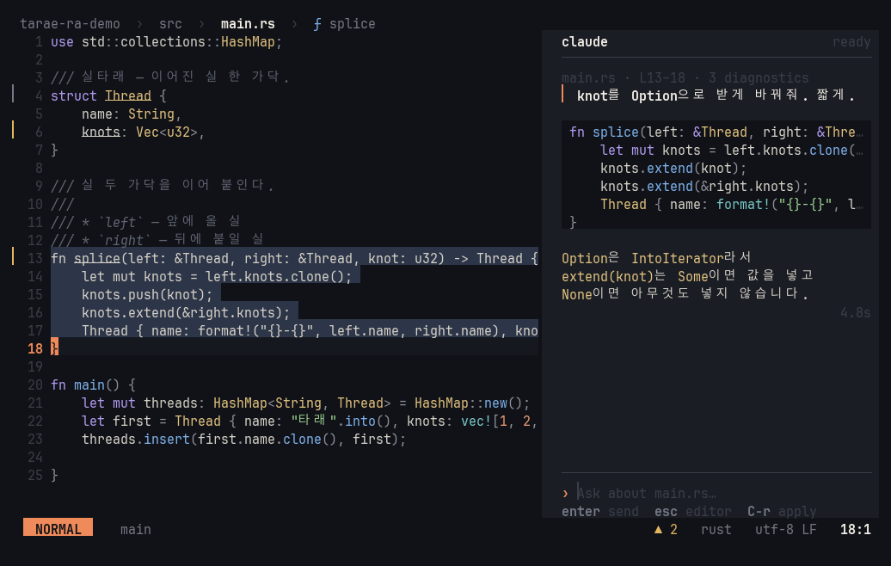

`space l` (or `:chat [question]`) opens a panel on the right; `space L` closes it and `:chat-new` starts over. One
process lives for the whole conversation, so Claude remembers what came before.

**The model** is named in the chat's title while it's idle (`Opus 5.5 · high`). `C-t` in the chat (or `:model`,
or "Choose Claude's model" in the palette) lists the models your `claude` offers, with the one in use marked
([screenshot](screenshots/chat-model.png)). `:effort` sets how hard it thinks, for models that take it. The
choice applies to the conversation at once, with no restart and no lost context: the next answer comes from the
new model. It's also saved (`llm.model`, `llm.effort`), so `space i` and later chats use it too.

Conversations outlive tarae. Each one is kept for its project, and Claude keeps its own memory of it
(`claude --resume`). Open the chat after a restart and the latest conversation carries on (`continued from 2 h
ago`) if you used it in the last 8 hours. Otherwise you get a fresh chat, and the empty panel lists your earlier
conversations. `C-p` in the chat (or `:chat-resume`) picks any of them, with the conversation as the preview
([screenshot](screenshots/chat-conversations.png)). The last 20 conversations of a project are kept, in
`~/.local/state/tarae/chats/`. Because Claude keeps the chat's conversations too, they also show in `claude --resume`
in that folder.

Every message carries **the current file, cursor, selection, and diagnostics** as context, plus **what's on
screen**: the lines you're looking at, and the file in the pane beside it when the window is split. So "this" and
"here" mean what you see, even when the cursor is somewhere else — the whole file only the
first time a version is sent, and just the area around the cursor for files over 60 KB. What was sent shows as chips
above your message (`main.rs · L13–18 · 3 diagnostics`). Answers render as Markdown, with code blocks in their
language's colors.

When what you mean is somewhere else on the screen (a card, a panel, a message, the terminal's output), Claude
can **ask to see your screen**. A card says what would go: the screen as text, whether the terminal panel is in
it, and that Claude can only look, with no keys or clicks. `y` sends it once, `a` lets Claude look again in this
conversation without asking, `n` says no. What goes is the screen as it is just after your answer, without the
card. `llm.screen-terminal = false` leaves the terminal panel out: its rows go blank, and the card says so.
To send the screen yourself, use `C-s` (below).

A card that asks something (this one, a command to run, a read outside the project) takes its answer keys in
the editor. While you're typing in the chat, or in a review, it leaves your keys alone and says
`C-q to answer it`: `C-q` gives the card the keys (the status line says `CARD`), your draft stays as it was, and
Esc goes back unanswered. Esc never answers a card. `n` does. A card counts what waits behind it — `1/3`: cards
under it, Claude's calls queued, cards in other sessions.

**The inbox** is everything waiting for your answer, in every session, oldest first: Claude's run and read
cards, its edits waiting for their review (`Change 1 of 2 · src/a.rs` — a protected file like `.tarae.toml`
always asks), change sets, and tarae's own cards (trust, a rebase, a download). The status line counts them all
(`▲3 waiting`) once anything waits beyond the card in front of you. `space I` (`:inbox`, or a click on the
count) lists them: each row names its session, what it asks, its kind and how long it has waited. `enter` goes
to it. Its session comes to the front and its card comes up with the keys, and you answer it there, on the card.
The list never answers anything itself. `C-q` follows the same order: it goes to the one that has waited
longest, whichever session it's in, and once that's the card up here, `C-q` gives it the keys. While anything
waits, `C-q` never says nothing does.


([hanji theme](screenshots/inbox-hanji.png))

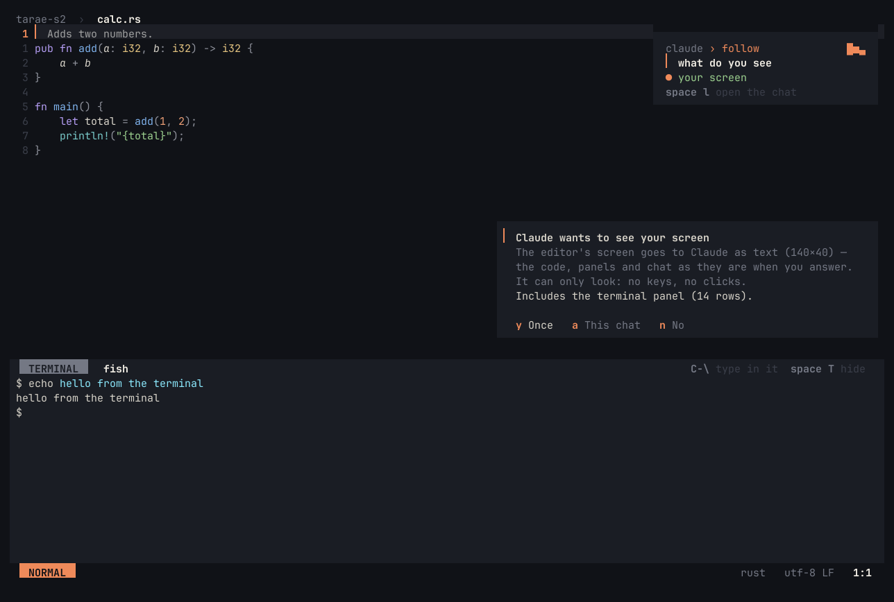

### What's on screen, by id

Claude also knows **what's on your screen by name**, without seeing it. Each message's context has one more
line when something's up beyond the code and the chat — the cards, the toasts, the runs under way, each by id:
`ui: card#12 run "cargo test" (claude, front) · toast#3 warning "…"`. So "why did this come up?" is answered
about the right card. Its `ui` tool says the rest: where the keys go, what each card asks and its answers,
the panes, the side panel's and the review's rows on screen, runs, and cards that went and how. It only reads,
asks no card, and is less than the screen: your own session in detail, other sessions only as a name, what
they're doing and how many cards; nothing you haven't sent (your draft, a prompt's text), no terminal output.

The ids Claude writes are **links**, underlined like `path:line`: `card#12`, `run#7`, `pane#2`,
`git:src/a.rs`, `review:src/a.rs`, `files:src/`. A click (or `C-]`) brings the element into sight — another
session to the front, a side tab shown and scrolled to the row, a run's panel in front of the bottom slot — and
it flashes for a moment. What the keys answer doesn't change: a card stacked behind flashes where it is. A card
that went says how (`card#12 went 2m ago: answered y — …`); an id that never was one is drawn faint, and says
`no such element`.

**Pointing**: `C-o` in the chat (`space @` from the code, `:chat-point`) puts a two-letter label on every
element on screen that has an id — the cards, the toasts, the side panel's and the review's rows, the slot's
tabs, the path bar. Type a label, or click the element, and its id goes into the chat as a chip over the input
(`card#12 goes with it`; Backspace in the empty input takes it off). The message tells Claude what you pointed
at. Esc stops pointing ([screenshot](screenshots/chat-point-hanji.png)).

For the turn in hand, what went to Claude carries a faint `◦` — a card at its title row's end (before `1/N`), a
panel row in its right margin, the path bar after the file — and what its answer cites a `•`. They go with the
next question. Toasts carry none.

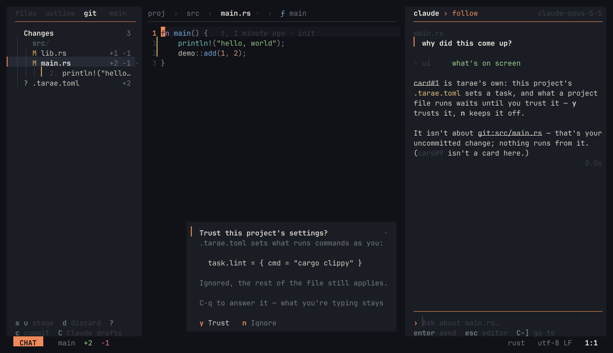

The chat reads your CLAUDE.md files and Claude Code settings the way `claude` does, so project rules apply to its
answers and edits. Two things differ on purpose: hooks don't run, and edits always come to you as a review, even
if a settings file allows them. `llm.chat-settings = false` starts it clean.

Claude isn't limited to that file: it **explores the project itself** (Read, Grep, Glob — in the project without
asking, [outside it only once you say so](#reading-outside-the-project); its [edits](#edits) always come to you
first). Each lookup shows as a quiet row (`◦ read  src/lib.rs  L10–49`, `◦ grep  fn add  in src` — each named as the tool it is),
the one in progress marked `●`. The other open files are listed in the context, and unsaved ones send their text,
since Claude would otherwise read the stale copy on disk. Answers cite code as `path:line`. Those references are
underlined, and a click opens them. `C-]` (or `C-g` — zellij takes that one) walks every place the conversation points at, newest first, centering
each one while the chat keeps the keys.

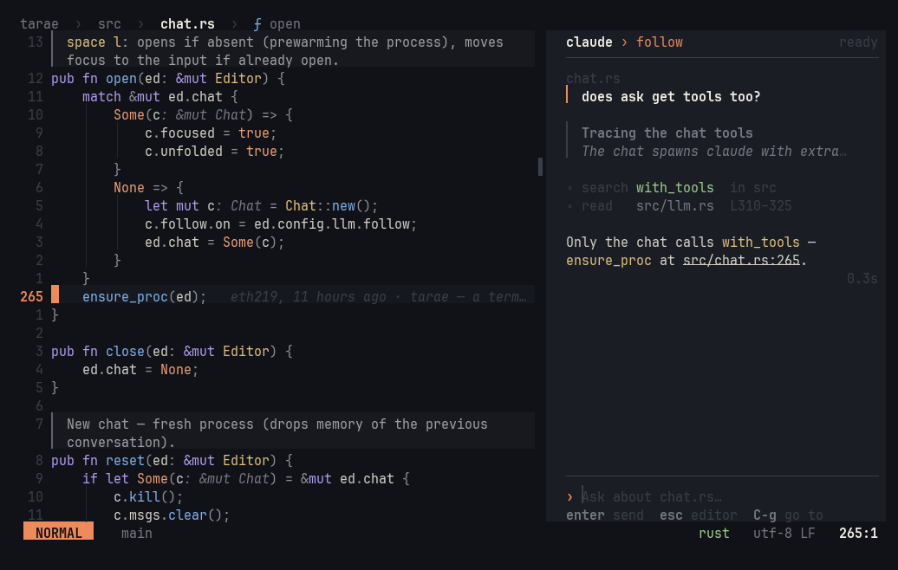

| Key | In the chat |
|---|---|
| `enter` | Send. While Claude works, it queues the message: the line over the input says `queued …`, and it goes when the turn ends. `↑` in the empty input takes it back to edit or drop |
| `alt-enter` / `C-j` | New line |
| `C-c` | Stop the answer (the conversation stays) |
| `C-r` | Replace the selection with the answer's code — through the same review |
| `C-y` | Copy the code |
| `C-s` | Send the screen with your next message: what you see, as text (`:chat-screen` from anywhere). The line over the input says `screen 140×40 goes with it`; Backspace in the empty input takes it off. The message's row opens a copy of what went |
| `C-o` | Point at something on screen: labels on the cards, rows, tabs and the path bar — a label's two letters (or a click) put its id in the message ([more](#whats-on-screen-by-id)) |
| `C-]` (`C-g`) | Go to where Claude looked or pointed, or to an element it cites by id (again = one further back) |
| `C-f` | Follow mode on/off (resumes if you took over) |
| `C-z` | Undo what Claude changed in its last turn ([more](#undoing-a-turn)) |
| `C-l` | New conversation |
| `C-p` | Continue an earlier conversation |
| `C-t` | Choose the model (`:effort` — how hard it thinks) |
| `esc` | Back to the editor |

### Follow mode

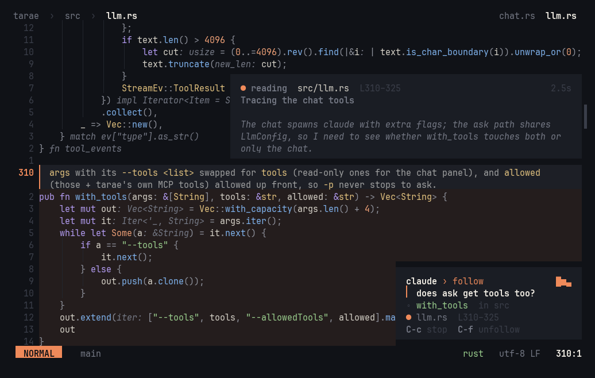
([hanji theme](screenshots/follow-hanji.png))

Follow is on by default (`C-f` in the chat toggles it; `llm.follow = false` starts with it off). The editor goes
where Claude is reading while it works. Each file it reads opens with the cursor on the first line read and
the range placed as a whole: left where it is if it's all on screen already, centred if it fits, and starting
near the top if it's taller than the screen. Those lines get a faint accent wash. Each edit is shown once it's
written, review at the end included: its new lines on the review's green wash, the lines it replaced in red
above them. A search or a lookup jumps to its first hit, with the count on the card (`1 matching line in 1
file`), and the finished answer takes you to its first `path:line`. A card beside the code names the tool and
what it's on (`● edit  src/trust.rs  L15–20`, `● grep …`, `● search (project) …`, `● definition Session`) and
shows what Claude is thinking, as a running log of the turn: a new thought goes under the last one instead of replacing it, so you
can follow the reasoning at your own pace ([screenshot](screenshots/follow-thinking.png)). Claude's thinking arrives as summaries, and the chat keeps each one as a folded italic aside. While
Claude works, the chat minimizes to a small card at the bottom right: your question, its last few lookups
(each a link) and the keys. The code gets the whole width, and the thought card takes the room above the lines
being read. The panel comes back with the finished answer, or right away with `space l` or a click on the card.
While Claude waits on you (a command or a read on its card, an edit under review), the card says `waiting for
your answer`, and over an edit's review it keeps to the room between the changes.

Moving in the editor (a key, a click or a paste that moves the cursor or switches files) pauses following.
Claude's edit reloading the file you're in doesn't, and neither does switching sessions. Follow takes over again
by itself `llm.follow-resume` seconds (20 by default; 0 = only `C-f`) after your last key if Claude is still
working. The next question also turns it back on.

**Replay.** Live, stops can come faster than anyone reads, so every stop of a turn is kept: each read with its
range, each edit with its changes, each search with its first hit and count, each command with how it ended,
each note. `[r` and `]r` step back and forward through them at any time, during the turn or after it. The editor
goes to each stop's lines, an edit shows its changes as the review does (where later edits have moved them), and
the card says which stop it is (`3/7`) and what Claude said right before it. Stepping past the newest stop
follows Claude again. A click on a tool's row in the chat, or `C-]` there, goes to that call's stop. The last
eight turns of the chat are kept. The chat's last row says `[r ]r replay its 7 stops`.

It follows what Claude talks about, too, not only what it reads. While it thinks, every `path:line` or
`path:start-end` it mentions shows at once, and a `name` in backticks goes to that definition in a file open here.
When it explains how something works, Claude writes a walk-through into its answer: a
`<show at="path:start-end">what this code does</show>` line before each piece, in the order of the flow (the
chat shows each as a link line). The editor shows the stops one by one, each for about as long as its
explanation takes to read, with the card saying what that code does there and which stop it is
([screenshot](screenshots/follow-show.png)). The stops go into the list (`]q` walks them again). The list is
announced once the tour is over, so its message doesn't compete with the stop's card. Scrolling the
chat stops the tour and moves the editor to the first reference the chat shows, so the code follows what you're
reading. It's plain text in the answer: no extra requests, a few words per stop.

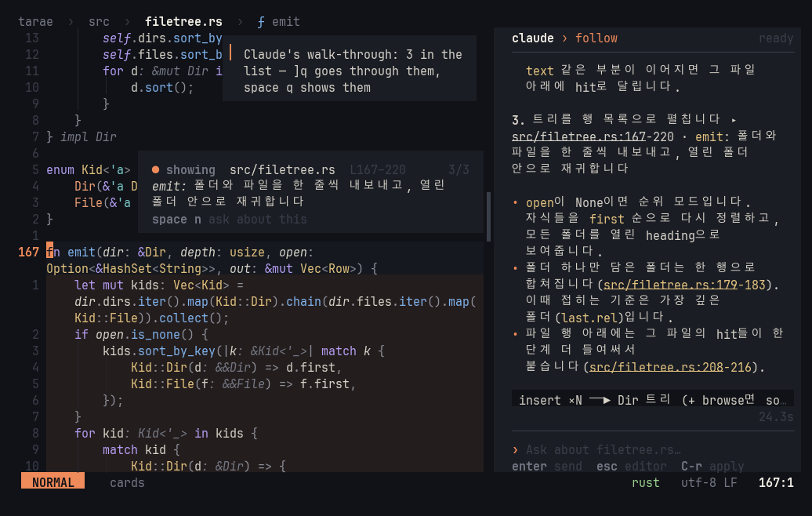

You can talk back at a stop. Once the answer is done, the stop's card says `space n ask about this`. The last
stop's card stays as long as your cursor is in its lines, even after the tour ends. Press `space n` and the tour
holds still while you type. Your question becomes a [note](#notes) on the stop's lines, and Claude gets
those lines along with what it said about them there. It answers in the note, next to the code.

Files opened along the way are previews: unedited ones close when follow moves on, in the pane you're in. Follow
stays in the project: what Claude reads elsewhere (its own memory files, say) shows on the card but isn't opened.
Moving the cursor, switching
files, or scrolling in the editor takes over: following pauses (`claude › paused`) until `C-f` or your next
question. `C-o` jumps back to where you were before the turn.

An empty conversation shows a short guide and example questions you can pick with `tab`
([hanji theme](screenshots/m4-chat-hanji.png)).

### The plan

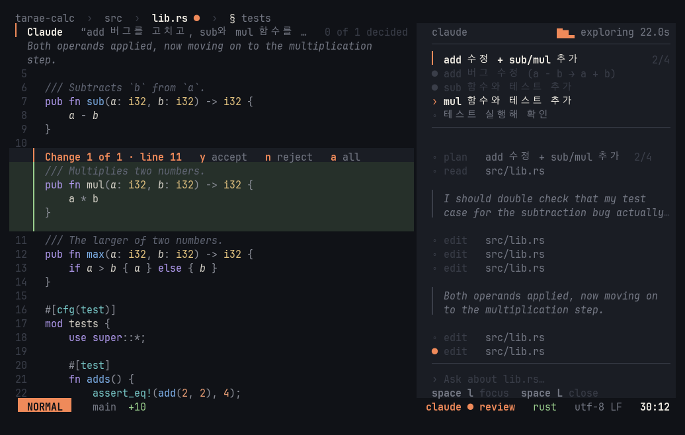

When the work takes several steps, Claude lays them out first and keeps the list current as it goes. It uses
tarae's `plan` tool for this. The plan is pinned under the chat's title with how far along it is (`2/4`).
Finished steps recede (`●`), the step in hand is in the accent (`›`), and the rest wait (`◦`). While Claude
works and the chat is minimized, the card shows the step in hand. A review of an edit made with no words
before it is headed by that step. When everything is done, the plan folds into one row (`all 4 done`). The
plan belongs to its conversation: it's kept and continued with it, and `C-l` starts without one.

### Edits

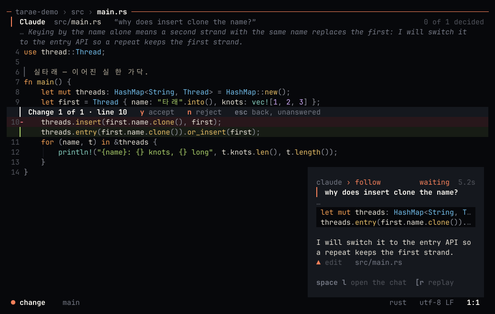

When you ask for a change, Claude edits files from the chat too, across as many files as it takes. Nothing is
written until you've seen it: each edit opens as the same in-buffer review as select → instruct → diff, headed
by what you asked for. The change in hand says what its keys do: `y accept this one`, `a accept all 2` (every
change still undecided), `n reject`, `esc back, unanswered` (shorter where the row is narrow); `q` rejects the
rest. Esc gives the keys back where they were before the review took them — the chat, or the code (NORMAL) —
and leaves the change waiting; `C-q` answers it. While it waits, `C-d` `C-u` (and
the wheel) scroll it, and `space`, `:` and `C-w` work over it. Under that title, Claude's own
words from just before it made the edit say why ([screenshot](screenshots/chat-edit-why.png)): what it
concluded, in a row or two. Its full reasoning is in the chat. The accepted changes are what gets
written. Accept part of a change, and only that part is written. Decline, and Claude is told so. Several edits
queue up one after another. A rename or replace of Claude's across several files comes as one card instead
(`Claude changes 10 files`, the change, each file's count): `y` accepts them all, `r` reviews them one by one,
`v` shows every change in a buffer, `n` declines them all.

A file with unsaved edits is a special case, because disk isn't what you're looking at. The accepted change stays
in your buffer, and Claude is told the file changes when you save.

### Review at the end

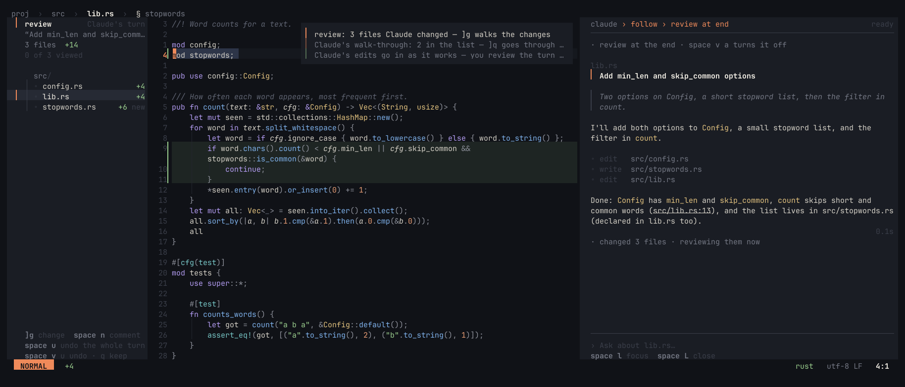

A long piece of work can mean dozens of edits, and a `y`/`n` for each one. Review at the end lets Claude work
through it and shows you the whole change once, the way you'd read a pull request. `space v a` (or
`:review-at-end on`) asks first, on a card that says what it means: Claude's edits go into your files as it makes
them, before you see them, and the checks it runs (`cargo test`, `cargo build`) run that code. `y` turns it on for
this chat. The chat's title says `› review at end` while it's on, and `space v a` turns it off. A new chat
(`C-l`) starts with it off.

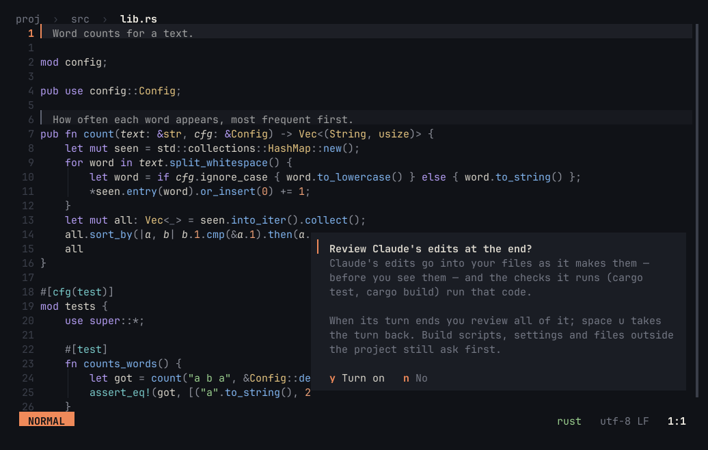

When the turn ends, the files Claude changed open as a [code review](#code-review), each against what it was before
the turn. What you asked is under the rail's head. `]g` walks the changes across files, `space v u` takes the change
at the cursor back, `space u` takes the whole turn back, and `space v q` keeps the rest. `space n` comments and
`space v s` sends your comments to Claude, as in any review. `space v t` (`:review-turn`) opens Claude's latest turn
as a review again, whether or not it was made this way.

Some edits still ask first, one at a time:

- files outside the project (where the link or `..` really leads)
- anything in `.git`, and the files in `llm.review-ask`: build scripts, manifests, and settings that decide what
  runs (`build.rs`, `Cargo.toml`, `package.json`, `Makefile`, `.tarae.toml`, `.cargo/`, `.github/`, `.claude/`, …).
  A name matches anywhere in the project, and a path with `/` matches from its root
- a file with unsaved edits of yours

The turns are kept on disk per project, so `:restart` (or a crash in the middle of a turn) doesn't lose them.
After a crash, a turn that was cut short comes back as a turn of its own, and you can review it and take it back.

### Undoing a turn

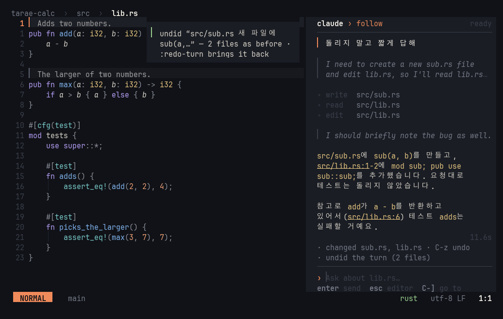

Whatever Claude changes in one turn is one step back, however many files it touched. When the turn ends, the
chat notes it (`changed sub.rs, lib.rs · space u undo`). Press `space u` anywhere (or `C-z` in the chat, or
`:undo-turn`) to put every one of those files back as it was before the turn. A file the turn created is
removed. `space U` (`:redo-turn`) brings the turn back. Press `space u` again to go back one more turn.

An accepted `space i` answer is a step of its own too: `space u` takes the latest back, whichever it was.

Your own edits since the turn stay. Only Claude's changes are taken out. Where you edited on or right next to
one of Claude's changes, that change is left alone too, and the toast says how many were left. Each file
changes as one step, so `u` in that file takes the undo back. Files that had no unsaved edits are saved
again, so the disk (what Claude, the tests, and git see) matches. Claude is told with your next message, so it
doesn't keep working from code that's gone.

| Key | |
|---|---|
| `space u` · `C-z` (chat) · `:undo-turn` | Undo the latest turn that's still applied |
| `space U` · `:redo-turn` | Bring back the turn you undid last |

### Running the tests

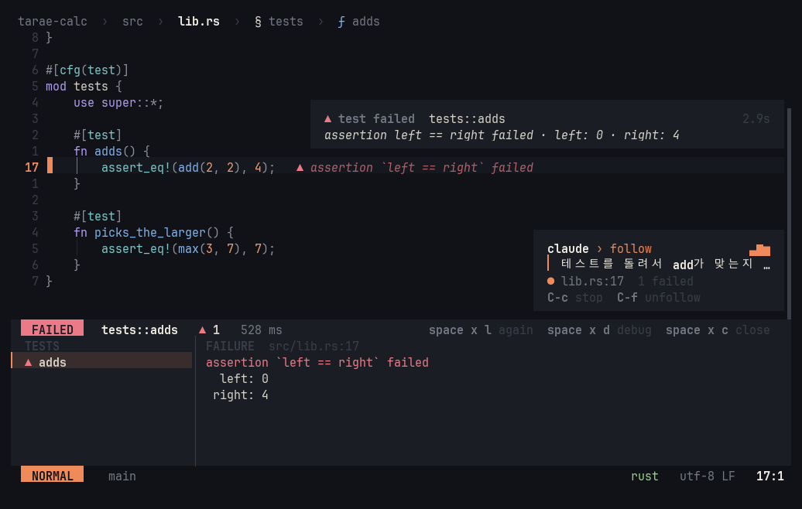

Claude checks its own work. After it changes code, it runs the tests that cover the change with tarae's
`run_tests` tool, reads why they fail, fixes the code, and runs them again. It passes a test file, plus a line
when it wants a single test. tarae finds the test in the syntax tree the same way `space x x` does and runs it in
the test pane below the code.

You watch it happen. The editor goes to the test while it runs (`● testing  src/lib.rs:17`). When the test fails,
the editor moves to the failing line and a card says why (`▲ test failed  tests::adds`). In the chat, each run is
a row that ends with its outcome (`◦ test  src/lib.rs:17  1 failed`).

- Claude gets the verdict, the counts, each failure with its place and message, and, when nothing failed by
  name (a build error, say), the end of the output
- It never cuts a run short. If tests are already running, it's told to wait. If you close the pane or start
  another run, it's told the run stopped
- Unsaved files are saved first, as with `space x x`: tests run what's on disk
- Rust, Go, Python, and Java, like the [test runner](testing-and-debugging.md#tests). A missing grammar shows the
  download offer, and Claude asks you to accept it

The tool runs without asking. It only runs the project's own tests, the same way you do and in plain view, and
every line Claude wrote for them went through your review first, unless you turned on
[review at the end](#review-at-the-end), whose card says so.

### Running commands

Claude can build, lint, format, run a whole test suite, and use git, all with tarae's `run` tool. Each call is
one command, run in the task panel the way `space m m` runs a task, and Claude waits for it to end.

- Claude gets how it ended (`exit 101 in 4.2s`), the places it pointed at (errors and warnings), and its
  output. Long output comes as its first 100 and last 150 lines
- Only a check or a build (`cargo build`/`check`/`test`/`clippy`, `go build`/`test`/`vet`, `make`, `npm test`,
  `pytest`, `tsc`, `ruff check` and the like) puts its places in your list (`]q`), as your own build would. A grep
  of Claude's looking around leaves your list as it was
- It runs in the project root, or in the folder Claude gives (`cwd`, inside the project)
- When it fails with an error, the editor goes there and a card says why, as with a failed test. In the chat,
  the row ends with the outcome (`◦ run  cargo clippy --all-targets  exit 101`)
- It never cuts a run short. If a task is already running, Claude is told to wait. If you stop it (`space m c`)
  or start another task, Claude is told it stopped
- Unsaved files are saved first, as with a task. There's no stdin and no terminal, so nothing interactive
- It isn't the task `space m m` runs again: that stays yours

**Checks run at once**: `cargo build`, `check`, `test`, `clippy`, `fmt`, `tree` and `metadata`, `go build`,
`test` and `vet`, `gofmt -l`, and git's `status`, `diff`, `log` and `show` (not `git diff --no-index`, which
reads the files it names: that's a read, below). `llm.run-allow` adds your own, as word prefixes
(`["npm test", "make lint"]`). A command only counts as one of those when it's one command and its words say
what runs: quoted words are fine (`cargo test -- 'a b'`), and so is `2>&1`. `$`, backticks, a redirect to a
file, pipes, `;`, `&&`, globs, a `VAR=value` before it, or an option that makes git write or run something
(`--output`, `--ext-diff`) and it asks like any other. One exception for pipes: a check whose output only goes
through filters that read it is still the check — `cargo test 2>&1 | grep -E 'FAILED|panicked' | head`, through
`grep`, `head`, `tail`, `wc`, `sort`, `cut`, `uniq` or `sed -n 'a,bp'` (none with an option that writes, runs or
never ends). It runs where the check alone would, its places still go to your list, and a card for one offers its
first words (below), as for the command alone. **A line of checks and reads** runs too when every part would on
its own — `cargo fmt && cargo clippy`, `cargo test; cargo clippy`, `cd sub && cargo check`, `cargo clippy -q &&
echo clean` — where it reads judged as below.

**So do commands that only read, when they read in the project**: `ls`, `cat`, `head`, `tail`, `wc`, `grep`,
`rg`, `find`, `tree`, `stat`, `file`, `du`, `diff`, `sort`, `uniq`, `cut`, `pwd`, `nm`, `otool`, `strings`, `size`,
`sed -n 'a,bp'` (line numbers only), `echo`, `printf`, `true` and `false` (they read nothing), and git's `blame`,
`rev-parse`, `ls-files`, `show` (`git show :2:src/a.rs`, `HEAD~1:a.rs`), `diff --no-index` and a bare `branch` —
git's `-C <dir>` too, the folder read like any other. Besides the project, the Rust toolchains' own sources
(`$(rustc --print sysroot)/lib/rustlib/src/…`, written out or just so — tarae asks rustup which toolchain that
is) and the crates cargo downloaded (`~/.cargo/registry/src/…`) read the same: code, nothing of yours. So do
the repository's other checkouts and the temp folders (as Claude's own reads, below). Not
cargo's home itself (its credentials), and a link in those folders is judged where it leads. So does the
project's own build folder where cargo puts it outside the project. Not with an option that writes, runs something or never ends (`find
-exec`/`-delete`/`-fprint`, `sort -o`, `tree -o`, `rg --pre`, `tail -f`, `uniq in out`, `git branch <name>`). A
line of them reads too: joined by `;` `&&` `||` `|`, with a `cd`, or the same inside `sh -c '…'` — `cd src &&
grep -n fn a.rs | sort | head`. Quotes keep what's in them as written: a `|` `<` `>` `*` inside them is part of a
pattern (`grep -E 'a|b'`, `rg "sleep\(|a *[<>]"` — a `\` in double quotes is read as sh reads it). Anything the
shell would fill in or run (`$`, backticks, a redirect to a file, `<`, a lone `&`, a `sh -c` inside the body) and
it asks. A loop of reads reads too: `for f in a.rs src/*.rs; do wc -l "$f"; done` is judged as each value's
read (a glob by its fixed folder), and `find src -name '*.rs' | while read -r f; do head -3 "$f"; done` when the
lines come from a list of names (`ls`, `find`, `git ls-files`, `rg -l`, `grep -l`, through `sort` `head` `tail` or
`grep` at most) and the variable is used in quotes at a word's start — as a name from that list, read where the
loop runs. A loop whose body writes or runs something, nests another, or uses a variable no loop sets asks.
Every path the line names is resolved where its part runs (after a `cd`, there — that folder is read
too; a glob by its fixed folder; links followed, `..` gone through): if one lies outside the project, the card
says which, since what it reads goes to Claude. `a` and `A` there work as on a
[read's card](#reading-outside-the-project): those places stay allowed, for the conversation or always — and
when two of them sit in one folder (or one sits beside a file you let it read once), the card offers that
folder, saying so: `a and A allow everything in /private/tmp/shots — not only these files`.

**Anything else asks first.** A card shows the whole command (and its folder, when it's not the project
root), `y` runs it, `n` tells Claude you said no. When the command starts with plain words that say what it is
(`cargo xtask shot …`), `a` runs it and lets commands starting with those words run without asking for the
rest of the conversation — the card says which words. It's never offered for a program that runs whatever
follows it (`sh`, `env`, `python`, `xargs` …), nor for git (what of it reads runs already; what writes goes to
`.git`, which the sandbox keeps), and never kept beyond the conversation. A pattern that sets names in front
(`A=… B=… cargo xtask shot`) covers the same command setting more names or fewer, each one a pattern may set
(never `PATH`, `RUSTC_WRAPPER`, `CARGO_HOME`, `RUSTUP_TOOLCHAIN`, `CARGO_ALIAS_…` and the like). A command
that runs a file of code — `sh x.sh`, `./x`, `python x.py`, `perl x.pl`, `awk -f x.awk`, `sed -f x.sed` — shows
that file's text on its card, since what runs is in it, not in the line (a long one is named, with its length);
`y` reads it again and runs nothing if it changed since. A command too long to
show whole on a card isn't put to you at all: Claude is told to write it to a script (that goes through your
review) and run that.

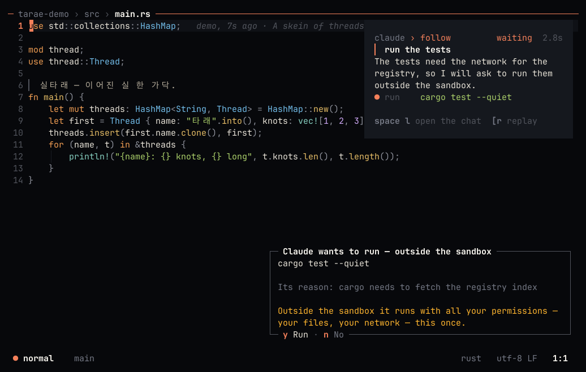

### The sandbox

What Claude runs, with `run` and `run_tests`, runs in a sandbox (macOS: Seatbelt). What you run yourself doesn't.

- It can write in the project, except the paths in `llm.sandbox-protect` and what runs later outside the
  sandbox or sets how things run, wherever it sits in the project and in any case: `.git`, `build.rs`,
  `Cargo.toml`, `package.json`, `Makefile`, `justfile`, `.envrc`, `.tarae.toml`, `.tarae.local.toml`, `.cargo`,
  `.github`, `.claude` and `.vscode` (`llm.review-ask`'s defaults, and the two your builds, `:preflight` and
  git read). A command can't make, change, move, remove or hard-link them; Claude is told which write was
  kept and to change it with Edit, which you review. Inside `target/` and `node_modules/` those names are
  tools' output (cmake's `Makefile`s, each package's `package.json`) and are written as usual. A command can
  hard-link only files it may write, so nothing from outside is brought into the project under another name.
  It can also write in the temp folders and the toolchain's own folders: cargo's caches (`~/.cargo/registry`
  and `~/.cargo/git`) only while the network is open — closed, they stay as they are, so nothing a command
  leaves there is picked up by your own builds later (every project's build uses the crates and git
  checkouts there, and cargo doesn't check them again). An offline build writes only cargo's lock and
  last-use files, the caches' `CACHEDIR.TAG` and the mark that keeps file sync off them. A build that needs a
  crate unpacked or a git dependency checked out fails, and Claude
  is told to ask you: a build or `cargo fetch` of yours puts it there. Go's caches, and cargo's target
  and build dirs (tarae asks `cargo metadata`) — those only when they're the checkout's own: inside it, its
  per-checkout build dir under cargo's home (`build/xx/yyyy`, worked out from your own `build-dir` setting,
  never the checkout's), or a temp folder. A cargo config in the checkout can name any folder, and Claude can
  write that config, so anything else it names — home, a folder holding the checkout, cargo's home, another
  folder — stays closed, and the run's panel and Claude's result say which (`llm.sandbox-write` opens a folder
  you choose). An edit to a `.cargo/config.toml` always asks first, even with review at the end. It can't
  write in `~/.cargo/bin` or anything else on your `PATH`
- It reaches nothing over the network, so a build that needs to download something fails.
  `llm.sandbox-network` lets it through, and `llm.sandbox-write` adds folders
- Unix sockets work only in the project and in a temp folder made for each run, which the command gets as
  `TMPDIR`. The sockets in `/tmp` and your own temp folder belong to programs running outside the sandbox
  (tmux, zellij, ssh-agent), and some of them would run whatever they're told. tmux's and zellij's socket
  folders (`$TMUX_TMPDIR` or `/tmp`, then `tmux-<uid>`; `$ZELLIJ_SOCKET_DIR` or `$TMPDIR/zellij-<uid>`) can't
  be written either, so a command can't delete or replace the multiplexer you work in
- **Programs on this machine are closed to it too, except on the ports you open.** It can still listen on a
  port; connecting is what's closed. Some ports belong to programs that run whatever they're asked, outside
  the sandbox (the table below), and macOS's sandbox can't open "all of this machine but those". So:
  - `llm.sandbox-ports = [3000, 5432]` opens just those ports: a dev server, a test database. At most 200, since
    each port is one more rule checked on every connect
  - `llm.sandbox-localhost = true` opens every port on this machine, for tests that talk to their own servers
    on ports picked at random. **That includes the ports in the table below**: it can't leave them out.
    tarae's own `.tarae.toml` sets it, because its tests do this
  - With `llm.sandbox-network` on, everything is reachable except the ports in the table, unless they're in
    `llm.sandbox-ports`

  | Port | What usually listens there |
  |---|---|
  | 2375, 2376, 4243 | Docker's API: it starts containers that mount any folder |
  | 8888 | Jupyter: it runs code in its kernels |
  | 9222 | Chrome DevTools: it drives the browser, signed in as you |
  | 9229 | Node's inspector: it runs code in the program being inspected |
  | 6379 | Redis: its `CONFIG` and `MODULE` commands write files and load code |
  | 2379 | etcd: a cluster's state, its secrets included |
  | 6443 | Kubernetes API server: it starts pods |
  | 10250 | kubelet: it runs commands in the node's pods |

  Like the other settings that run something or loosen a guard, a project's `.tarae.toml` sets these only
  once you trust the project
- **When the sandbox blocks something, it says so.** tarae watches the system's report of what the sandbox
  denied, while the command runs. The run's panel shows the first thing blocked on its bottom row
  in plain words (`▲ sandbox blocked writing ~/x  +2`, `connecting to port 9`, `opening apps`). If the command then prints nothing for 15 seconds, a quiet
  note says it may be waiting on what was blocked: a blocked terminal or socket can hang a program instead of
  failing it. Claude's result lists what was blocked, or says nothing was, along with which ports were open.
  If tarae can't watch (`log stream` refuses to run inside another sandbox), the result says so and quotes
  the output's `Operation not permitted` lines instead
- **What it blocked is yours to open**, never Claude's: `space m s` on a command's panel (`space x s` on a test
  run's, or `:sandbox-blocked`) lists what could open. For a write, each folder from the one written in up
  to just below home, so you choose how wide. For a connection, that port on this machine — or that unix
  socket, the one file (colima's `docker.sock`), offered `y` this run or `a` this conversation, never kept;
  Docker's says, in the warning color, that what connects to it can start a container that mounts any
  folder. And, last, running the command once outside the sandbox. A folder's or a port's card offers `y` once,
  `a` this conversation, `A` always in this project; whichever you pick, the command runs again now with it
  open. "Always" is kept in
  your own state (`$XDG_STATE_HOME/tarae/sandbox.json`), and `:sandbox-allowed` lists it with what Claude may
  read, Enter taking one back. Some places are never offered, only set by hand in `llm.sandbox-write`: home and
  above it, folders that hold keys, folders on your `PATH`, shell, git and tarae settings, launch agents, the
  project's `.git`. Neither are the ports in the table above. Running it outside is a weighty card of its own,
  and only ever once. These runs are yours, not Claude's: Claude hears how one ended with your next message,
  and from then on its results say what you opened
- **Claude can ask to run a command outside the sandbox**, when one can't work in it (it needs the network,
  say), but only with a reason. Its card always asks, even for a command that would otherwise run at once.
  It shows the command, Claude's reason, and that it runs with all your permissions, this once: `y` or `n`,
  nothing kept. A request without a reason is turned back before it reaches you. When all it needs is one unix
  socket (a server's — `cargo xtask linux` talks to colima's Docker), Claude asks for that instead
  (`unix_socket`): the card names the file, says everything else stays in the sandbox, and offers `y` this
  run or `a` this conversation
- **Since your last y.** When Claude asks again for a command you already said `y` to outside the sandbox in
  this conversation (the same command, from the same folder), its card says when that was and shows only what
  changed since in what the command runs. For a command that runs the project's code (`cargo test … parser::`)
  that's the project's changed hunks, the lines around each change dim, what came and went in the diff's
  colours. For a script (`sh check.sh`, `python3 x.py`) it's the script's own diff, shown in place of the whole
  script. Nothing changed: `Unchanged since your y at 01:12`. It never answers for you. The card waits for `y`
  as before, but you only read what's new. Nothing outside the project is shown: a script there is named as
  changed, never shown. At each `y`, tarae keeps a snapshot with the conversation: the scripts' text, or the
  project's working tree as a git tree (staged into a temporary copy of the index, so your own index isn't
  touched, with no hooks). A new conversation starts with none

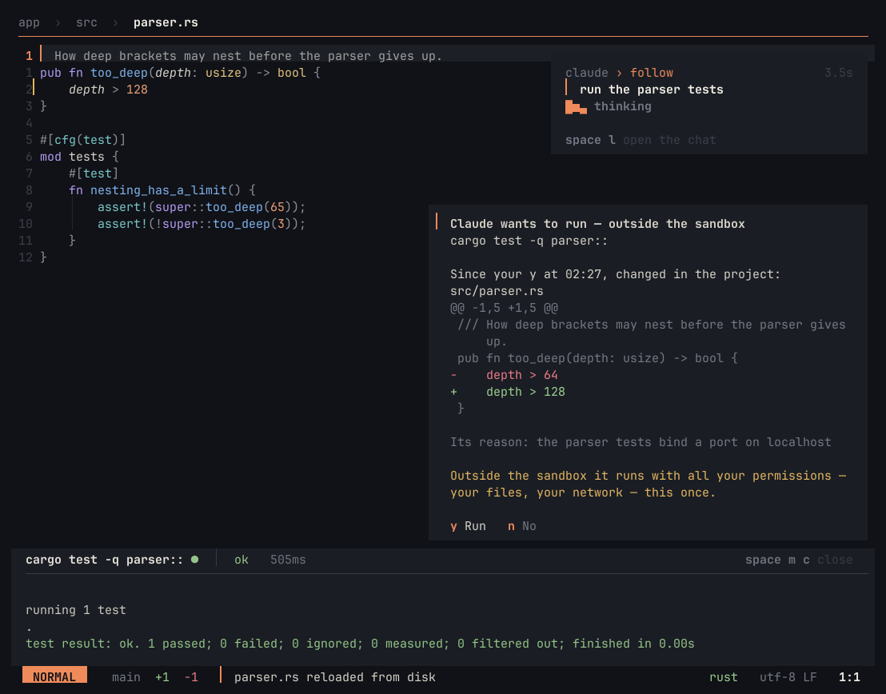
([hanji theme](screenshots/since-your-y-hanji.png))

- git's read-only commands run with `GIT_OPTIONAL_LOCKS=0`, so `git status` doesn't try to refresh the index
  in `.git` (a write the sandbox would deny and report)
- **Where there's no sandbox** (Linux for now, or tarae itself running inside one), Claude's commands don't
  quietly run without one. A card says there's none: `y` runs this one, `a` runs the rest of this conversation's
  commands too, and `n` says no. While they run without one, the chat's title says `› no sandbox`.
  `llm.sandbox = false` turns the sandbox off; the title says so too

### Reading outside the project

Claude reads the project freely: its Read, Grep and Glob go through without asking wherever the path really
leads into the project (links followed). So do the repository's other checkouts (the main one and each
session's — as git's own files say, both ways: an entry under `.git/worktrees` whose folder doesn't name it
back is no checkout), the temp folders (`/tmp`, your `$TMPDIR`), the toolchains' sources and the crates cargo
downloaded. Outside those, a card says exactly what would be read: the file, or the folder searched and what
for. What's read goes to Claude.

- `y` once · `a` this conversation · `A` always, in this project · `n` no
- "This conversation" and "always" cover the place: the file, or the folder and everything in it. The
  "always" answers are kept in your own state (`$XDG_STATE_HOME/tarae/sandbox.json`, per project), not in the
  project's files. `:sandbox-allowed` lists them, and Enter on one takes it back
- Home itself, the folders above it, and places that hold keys (`~/.ssh`, `~/.aws`, `~/.gnupg`, `~/.kube`,
  `~/.docker`, `~/.config/gh`, `~/.netrc`, …) are only ever allowed once
- Each answer on a card is one `card` line in tarae's log (`~/.local/state/tarae/tarae.log`): the session, why
  it asked, where the read goes, what the planned card model would do instead, your answer and how long it
  was up — and each run the sandbox denied something is a `denied` line. That's how the cards are counted
  (`docs/design/cards.md`)

### Notes

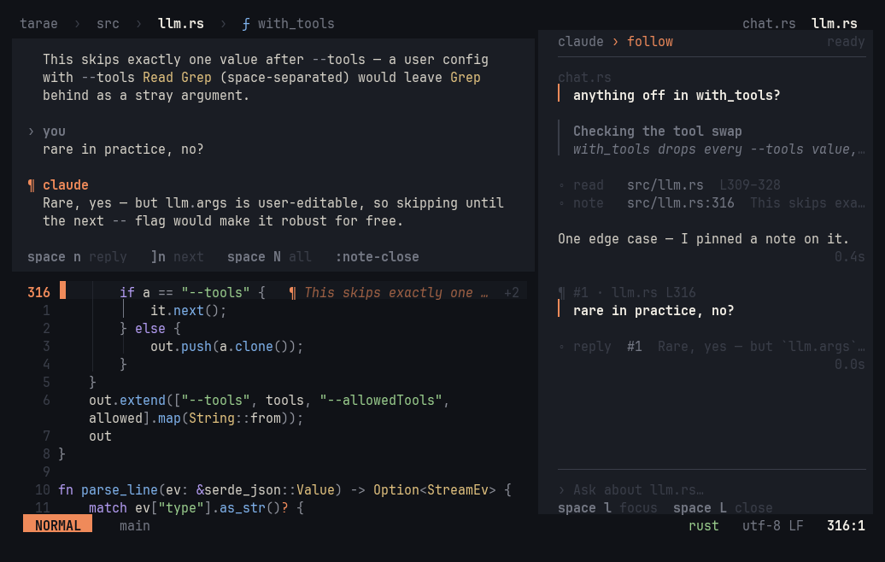

Claude can pin **notes** to lines of code: a bug, a risk, or a question tied to specific lines. A note shows as
`¶ first words` at the end of its line, and with the cursor on those lines a card shows the whole thread. Notes
ride edits (lines added above push them down), and the next start in this folder brings them back.

Talk back right there: `space n` on a note line replies. Your reply goes to Claude together with those lines and
the thread so far, and Claude answers on the thread. `space n` on a line without a note asks Claude about that
line (or the selected lines), which starts a new note with your question.

| Key | Notes |
|---|---|
| `space n` | Reply to the note here, or ask Claude about this line |
| `]n` / `[n` | Next / previous note, across files (notes sharing a line one by one) |
| `space N` | Every note, with a preview |
| `:note-close` / `:notes-clear` | Close the note here / all of them |

The card sits beside the note's lines, below them or above them, so the code the note is about stays in
view. When several notes share a line, the line end says how many (`¶ 3 notes · …`). The card shows one at a time
(`note 2 of 3 here`), and `]n` reads them in order. Floating cards never cover each other. The note at the
cursor is placed first, the minimized chat takes a free corner, and the thought card takes what's left. On a
small screen, a card with no room waits for the next frame that has room.

Under the hood the chat process gets tarae's own `note` tool: an MCP server that lives inside tarae and speaks
over the same stream as the conversation, so no server or port is involved.

### What it costs

The last row of the chat says how warm Claude's prompt cache is and what the conversation costs:

```
● warm until 14:32  ctx 4% of 200k  turn $0.018  read 7.9k write 8.1k in 18 out 185
```

- **Cache**: warm until its TTL runs out, by the clock — 5 minutes or an hour from the last request that wrote
  or read it, as that request's cache write says; then `◦ cold`. Said as a time, it stays true while nothing
  redraws; the only frame while you're idle is the one when it turns cold. (`tarae state` says the seconds
  left.)
- **Context**: the last request's input + cache read + cache write, against the model's window (the window comes
  with the first turn's result, so the first turn shows the token count).
- **The last turn**: its cost, then its tokens read from the cache, written to it, sent as input and written out.
  Claude reports the cost as a whole; the four numbers are tokens, not dollars.

When the chat is narrow the words fold first, then the split, then the context; the cache stays. The session list
(`space W`) has a column with each session's cache and its total so far. `:usage` opens a buffer with a row per
turn (time, model, input, cache write, cache read, output, hit rate, cost), the session's total, what every
request in the conversation starts with (its first request: the system prompt, the tools, CLAUDE.md and the
first message), and today's total across sessions. It updates as turns end.

What claude doesn't send isn't guessed: another CLI's turn shows its counts as `not reported`, and a conversation
continued from before tarae kept its cost says the first turn's cost wasn't reported (claude's total covers the
whole conversation). The turns, the cost so far and the cache go with the conversation in `$state/chats/`, so a
continued one picks up where it was. `tarae state` carries each session's usage, and `--watch usage` is told
when a turn's result comes and when a cache goes cold.

## Commit messages

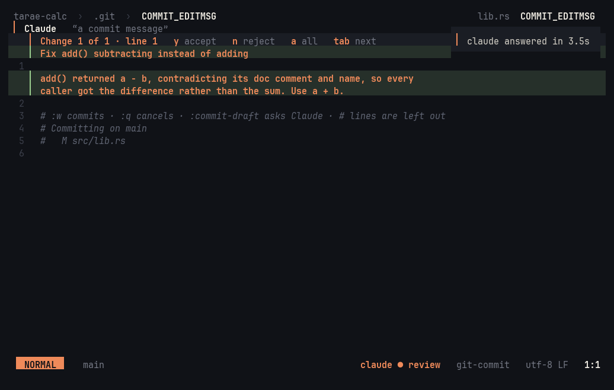

In the git tab, `C` commits with a message Claude drafts. `c` is the plain commit. `C` opens the commit message
buffer and Claude writes the draft from what's staged, in the style of the repository's recent messages (their
subject lines, how they explain, the trailers they use). The draft streams in and lands as the usual in-buffer
review. Take it (`a`), edit it, and `:w` commits. In a message you already opened, `:commit-draft` asks for one.
When amending, Claude reads the whole commit and proposes a new version of the message.

## Code review

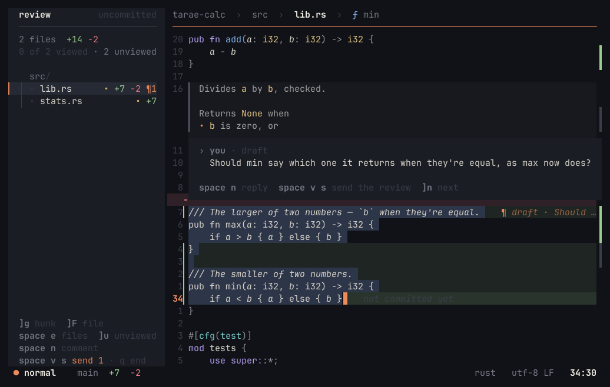

Once Claude has changed a lot (or anyone has), review it the way you'd review a pull request, and send your comments
back in one go. It works on the real buffers, so every motion, go-to-definition, and hover still works while you read.

- `space v v` reviews the uncommitted changes against HEAD. `:review <branch>` reviews everything since this branch
  left another, committed and not, like a pull request's diff. The branch can be local or remote (`origin/main`, which
  is fetched first), and branch names complete as you type
- A rail on the left lists the changed files with their `+added −removed` counts and your comments. Removed lines show
  in red where they were; added and changed lines sit on a green wash. `]g`/`[g` walk the changes and go on into the
  next or previous file. `space e` gives the rail the keys: `j`/`k` over the files, Enter opens one, `m` marks it
  viewed and goes on to the next, Esc back to the code. A click on a file opens it, a click on its `◦` marks it
  viewed too (a second click leaves it marked), and a click on `↑ N more` / `↓ N more` or the wheel scrolls the list
- `space n` on a line writes a **draft** comment (the same key as everywhere else; during a review it drafts instead of
  sending). Drafts show as `¶ draft · …` and in the rail, and `]n` walks them
- `space v s` sends every draft to Claude in one message, each with its lines as a diff. Claude answers every comment
  on its note and makes the changes, which come to you as the usual [edit review](#edits)
- `space v m` marks a file viewed, again unmarks it. The mark stays while the file's diff is what it was — ended and
  opened again, the review keeps it — and a change to the diff takes it back. `space v q` ends the review (with files
  not viewed it asks first, on a card naming them), and the gutter goes back to comparing against the index

### Claude reviews your changes

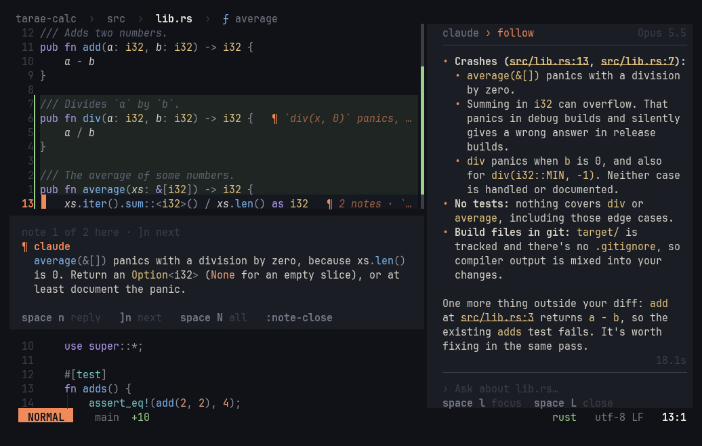

It works the other way too. `space v c` (or `:review-claude [branch]`) opens the review if it isn't open and
hands Claude the whole diff, untracked files included. Claude reads the code around the changes as it needs to,
pins each finding to its lines as a [note](#notes) (bugs, cases that break, missing tests, and no style nits),
and gives its verdict in the chat. It doesn't change files. Answer a note with `space n`: in a review that's a
draft, and `space v s` sends your answers together.

| Key | In a review |
|---|---|
| `space v v` / `:review [branch]` | Start (against HEAD / since a branch) |
| `]g` / `[g` | Next / previous change, across files |
| `space n` | Draft a comment (or a reply) on this line |
| `space v m` | Mark this file viewed (again: not viewed) |
| `space e` | The rail: `j`/`k` files, Enter open, `m` viewed and next, Esc back |
| click on a file's `◦` | Open it and mark it viewed |
| `space v u` | Take the change at the cursor back |
| `space v z` | Read wide: the rail and the chat give the code their columns (again: back) |
| `space v s` / `:review-send` | Send the drafts to Claude |
| `space v c` / `:review-claude` | Claude reviews the changes: notes on the lines, a verdict in the chat |
| `space v q` / `:review-close` | End the review (asks first while files aren't viewed) |
| `space v t` / `:review-turn` | Review what Claude changed in its latest turn |
| `space v a` / `:review-at-end` | [Review at the end](#review-at-the-end): Claude's edits go in as it works (asks first) |

## Rebasing a session

A session (`space W`) is a branch in a checkout of its own. `:session-bring` (or `b` in the session list) moves
its base up to it, fast-forward only. When the base has moved since the session left it, a card says how far
(`main moved 3 commits since fix-login left it; fix-login is 2 commits ahead`) and offers to rebase first:

- `y` rebases it onto its base in its checkout. tarae runs git itself (Claude's sandbox can't write `.git`), as
  `git rebase <base>` in the task panel — with hooks off: a hooks folder inside the checkout is one Claude can
  write, and this git runs outside the sandbox. A stop at conflicts reads `stopped: 2 conflicts` there, not failed
- Clean: a card offers to bring it now (`y`), to run the quick [`:preflight`](configuration.md#checks-before-a-push-preflight) first and bring it once that
  passes (`p` — the card names its steps; the `full = true` ones wait for `:preflight-full`, before publishing), or not now (`n`)
- A conflict: the rebase stops, and the session's own Claude is asked in its chat to resolve the files. It's
  sent the files and both sides (what the commit being replayed changed, and what the base changed since that
  commit's parent), and told not to run git or commit. When its turn ends with no conflict markers left in
  those files, a review shows them against the commit being replayed, and a card offers to continue (`y`: tarae
  stages them and runs `git rebase --continue`, which may stop again — the same loop) or abort (`X`: back to
  where the branch was). Markers left: the files are named, and the rebase waits

While it's under way the session's tab, the status line's chip and its row in the list say `rebasing 2/5`, and
`:session-end`, `:session-bring` and `:restart` wait for it (they say why).

| Command | What it does |
|---|---|
| `:rebase-continue` | Stage the stopped rebase's files (no markers left) and go on |
| `:rebase-abort` | `git rebase --abort`: the branch back where it was |

Both also take up a rebase tarae didn't start — one begun by hand in the session's terminal, or from before a
restart.

## Settings

```toml
[llm]
command = "claude"   # a CLI speaking Claude Code's stream-json protocol
model = "haiku"      # "" = the CLI's default model
context-lines = 20   # lines around each selection sent along
```

All of them, with defaults: [settings reference](reference/settings.md#llm).
